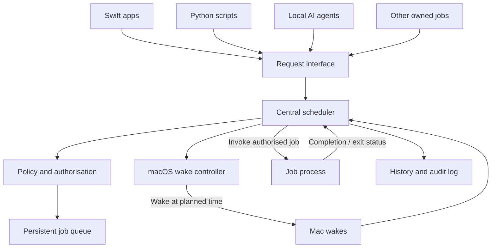

# Wake Up Scheduler: Design Notes

Source: handwritten project sheet and notes (dated 31/10/26) plus a printed design draft, scanned 10 Nov 2026. This is a transcription for discussion. Nothing here is decided unless it says so.

## Project sheet

- **Status:** Planned / Active
- **Goal:** A wake-up scheduling system with a UI that manages ALL system wakeups across projects.
- **Blockers:**
  - MacBook
  - Decide how
- **Next actions:**
  - Prototype, develop
  - Decide stack
  - Scope?
  - Worth?
  - Caffeinate
- **Decisions:** Python, TypeScript with Electron or similar, or fully Swift. (Since decided: fully Swift. See "Decisions made".)
- **Open question:** How to block any attempt to wake the Mac (other than by Apple OS / the Mac itself) and enforce the use of the scheduler?

## Core principle

**The scheduler owns wake authority. Jobs own only their work.**

No process other than the scheduler or macOS ever wakes or controls the Mac. Every task stays visible and manageable in one place, without each app or script running permanently or keeping its own wake timer.

## Overview

A lightweight, continuously running scheduler is the single authority for when the Mac may wake and which jobs may execute.

Every other application, script or agent is a client. It requests permission from the scheduler, then becomes dormant. The scheduler wakes the Mac, invokes authorised jobs, tracks their execution and coordinates completion.

The scheduler does not need to understand what a job does. It only manages authorisation, timing, invocation and execution state.

## Architecture



### Responsibilities

| Component | Responsibility |
|---|---|
| Scheduler | Owns policy, queue, timing, invocation, and job state |
| Wake controller | Schedules and manages system wake events |
| Request interface | Accepts job requests and completion reports |
| Job process | Performs its specific task, then exits |
| Persistent store | Stores jobs, permissions, schedules, and history |

The scheduler is the only intentionally persistent application-level process. Job processes run only when invoked.

## Job lifecycle

```mermaid
sequenceDiagram
    participant Job as Job/client
    participant Scheduler
    participant macOS

    Job->>Scheduler: Request execution at 06:00
    Scheduler->>Scheduler: Check identity, policy, and time limits
    Scheduler-->>Job: Authorised (or rejected)
    Note over Job: Client exits; no timer or background process remains
    Scheduler->>macOS: Schedule wake for 05:55
    Note over macOS: Mac sleeps until scheduled wake
    macOS->>Scheduler: Scheduler becomes active after wake
    Scheduler->>Job: Invoke job at/around 06:00
    Job->>Job: Perform its work
    Job->>Scheduler: Report completion and result
    Scheduler->>Scheduler: Record result and update queue
    Note over Scheduler,macOS: Sleep may be requested when no work remains
```

The five-minute lead time is an example policy, not a guarantee that the Mac will be fully ready at an exact instant.

Handwritten version of the same flow: app requests wake and alert, scheduler handles/plans/executes, Mac is woken about 5 minutes before and the app is initiated/alerted, app finishes and alerts the scheduler, scheduler releases its hold over the Mac.

## Request protocol

All clients use one shared request protocol, whether the work is a Swift executable, Python script, shell command or local AI agent.

The app must support a protocol over which it is alerted.

### Example request (printed draft)

```json
{
  "job_id": "youtube-generation-001",
  "name": "Generate YouTube Video",
  "executable": "/usr/local/bin/python3",
  "arguments": ["/path/to/youtube.py"],
  "scheduled_at": "2026-11-01T06:00:00",
  "wake_lead_time": 300,
  "timeout": 3600,
  "permissions": ["network", "filesystem"]
}
```

### Example request (handwritten sketch)

```json
{
  "date": "10-12-26",
  "time": "12:00 am",
  "appId": "uuid",
  "estimateTime": "30"
}
```

`estimateTime` is in minutes, for scheduling only. It annotates two branches:

- The channel through which the app is called. If the app doesn't permit running in the background, the scheduler handles that.
- If the slot is already scheduled: alert the user, or allow both, until there is feedback.

### Response

The scheduler validates the client and request, then responds with an authorised or rejected result and a reason.

In a real implementation, client identity must be authenticated. A caller must not be able to gain trust merely by claiming a job ID.

### Request requirements (handwritten)

- The request structure must contain the **resource intensity** of the scheduled task, i.e. a small task should be allowed to run.
- If a request doesn't conform, and the app attempts to wake the Mac itself: **BLOCK**.

## Central policy

The scheduler can enforce rules such as:

- Only registered, trusted jobs may submit requests.
- Reject requests outside permitted operating hours.
- Reject jobs that would overlap a user-reserved period.
- Enforce maximum execution durations and resource policies.
- Combine nearby jobs into a single wake period where practical.
- Track concurrent jobs and choose whether to run them in parallel or sequentially.
- Record unexpected wake activity and surface warnings when the user next opens the app.

Example queue:

| Job | Requested time | Planned wake |
|---|:-:|:-:|
| AI video generation | 06:00 | 05:55 |
| GitHub backup | 06:30 | 06:25 |
| Website build | 06:45 | 06:40 |
| Database maintenance | 07:00 | 06:55 |

The scheduler maintains one central queue and manages the system wake schedule, rather than giving every job its own timer.

## Three separate decisions

1. **Authorisation:** Is this client/job permitted to request work?
2. **Scheduling:** When is it permitted to run?
3. **Execution:** Is it currently permitted to use the Mac?

A job never owns the right to wake the Mac. It only has the ability to request permission from the scheduler.

## UI (handwritten)

- If something is rejected, it is sent back as "pending manual approval", which the user resolves in the app UI.
- App notifications, and a clean UI as well.

## macOS implementation notes

- A LaunchDaemon or LaunchAgent can keep the scheduler available, depending on whether jobs must run before user login or in the logged-in user's session.
- `IOPMSchedulePowerEvent` / `IOPMCancelScheduledPowerEvent` are relevant IOKit APIs for scheduling and cancelling system power events. Scheduling requires appropriate privileges.
- Use a local IPC mechanism such as a Unix domain socket, with authenticated clients.
- Store the queue and execution history persistently (for example, SQLite).
- Use a shared client library so Swift apps and scripts follow the same request/completion contract.
- A job should be an independent executable. The scheduler invokes it with an execution ID and required parameters; the job reports its result and exits.

**Important limitation:** Public macOS APIs do not provide a universal firewall that intercepts and rejects every third-party wake request before it reaches the operating system. The scheduler can centrally control the jobs you build to use its protocol, manage scheduled wake events it can inspect, and detect/report unexpected wake activity where macOS exposes evidence. It cannot guarantee that unrelated software or hardware will never wake the Mac.

## Decisions made

- **Stack:** Fully Swift, ideally.
- **Source precedence:** The handwritten notes are the plan. The printed draft is a more technical summary generated from them. Where the two conflict, ask rather than assume.
- **Invocation model:** The scheduler is the only app that runs permanently. A client that wants to be woken files a request that includes a **method of awaking** (how the scheduler should alert or launch it). The flow is:
  1. The client files a request and goes dormant.
  2. The scheduler wakes the Mac.
  3. The scheduler alerts the client using the method from its request.
  4. **The scheduler holds the Mac awake. The client is never allowed to.**
  5. The client finishes and, as its final action, alerts the scheduler.
  6. The scheduler logs the result, runs its checks, then allows the Mac to sleep.
- **Duration:** `estimateTime` is used for planning. When a job overruns its estimate, the scheduler alerts the user, who decides whether to extend or stop it. There is no hard-kill timeout.
- **Methods of awaking:** `exec` (executable, arguments, working directory, environment: covers Python, shell scripts, CLI tools) and `app` (macOS app by bundle ID). Enough if it covers nhl-recorder and ClaudeWriter nightshift. A small CLI lets scripts file requests and report completion.
- **Startup check:** Shortly after the wake, the scheduler checks the client actually started. If it never starts, the scheduler releases the hold.
- **At the estimated time:** The scheduler checks whether the client is still running. If it is, the user gets a notification and the job is **not** terminated. If it failed or isn't running, the scheduler logs it and releases the hold.
- **No response to an overrun:** The job keeps going, unless the Mac's battery falls below a threshold set in the app, in which case the scheduler terminates the job and releases the hold.
- **Packaging:** Everything ships inside the app and is installed from the app. The app is not sandboxed.
- **Privileges:** Whatever is needed for the best way. See the architecture proposal below.
- **What we block:** Only future wakes booked by other apps (scheduled and repeating power events). Keep-awake assertions (`caffeinate`, `IOPMAssertion`) are **not** blocked. Apple's own wakes (`com.apple.*` owners, `dasd`, `powerd`, network and hardware wakes) are left alone.
- **Enforcement:** Notice and cancel, plus an alert to the user. The main risk is not the user's own deliberate work but Claude Code forgetting the scheduler exists and building its own wake mechanism, so Claude Code hooks are wanted too.
- **Claude Code guard:** The app installs the hooks into the global `~/.claude/settings.json` (so they cover nhl-recorder and ClaudeWriter too). Claude does not install them by hand. A blocked command's message tells the agent what to do instead and points to an agent guide file installed by the app, which documents the request CLI, schema and examples.
- **Dev-mode escape hatch:** For development and testing only. Off by default, toggled by the user in the app, with an auto-expiry, so an agent can't switch it on itself.
- **Sudoers migration:** The existing NHL and nightshift passwordless `pmset` rules are replaced by another agent, which will test that those projects still work through the scheduler. Not part of this project's code.
- **Client identity and approval:** A client is an app or project, identified by its **location** (app bundle path or project folder). The request also carries a display name shown in the UI. The scheduler checks that the location matches the one approved. It is a personal Mac, so there is no code-signing or hardening beyond that. **The client is approved once, not each job:** once an app or project is approved, all of its jobs and wake requests are allowed (subject to the intensity and battery rules).
- **Resource intensity levels:**
  - **Low:** up to 30% CPU, up to 50% GPU, up to 2 hours. Always runs (subject to the 30% battery floor).
  - **Medium:** everything between low and high. Runs if the battery is above 80%.
  - **High:** above 80% CPU, above 80% GPU, or over 3 hours (any one of these makes it high). Runs when plugged in, or on battery above 60% if the user allows it for that job in the app UI.
- **Intensity input:** Clients give only expected CPU and GPU percentages. The scheduler derives the level. It also measures actual use during each run so a trend can be spotted and a job reclassified by hand. It never changes a level automatically.
- **Minimum macOS:** 27 (the project already targets it). Signing uses the project's existing development team with automatic signing.
- **Battery gates:** No job runs below 30% battery. Each job can also have its own battery gate, set in the app UI.
- **Missed occurrences:** If a job's start time was missed by less than 5 minutes, run it as soon as possible. If by more, alert the user and skip that occurrence.
- **Logged out, rebooted or FileVault:** Best effort. Do it if the app can, otherwise accept and document the limit. This Mac (an iMac) has FileVault on.
- **Slot conflicts:** The scheduler alerts the user. The details (what the alert offers, what happens if there's no response) still need finalising.

## Findings from existing projects

Two existing projects already wake the Mac and hold it awake, so they are the test cases for the scheduler: **nhl-recorder** (`~/nhl-games-on-server/nhl-recorder/nhlrec/power.py`, plus the `mac-studio-kit/wake_test.sh` test kit) and **ClaudeWriter nightshift** (`~/ClaudeWriter/tools/nightshift.py`, adapted from the NHL code).

Both use the same mechanics:

- **Waking:** `sudo -n /usr/bin/pmset schedule wake "MM/dd/yy HH:mm:ss" <owner-tag>`. A sudoers rule (`/etc/sudoers.d/...`) allows only `pmset schedule *` and `pmset sleepnow` without a password. The owner tag lets each project cancel only its own wakes with `pmset schedule cancel wake <time> <owner>`.
- **Holding awake:** `caffeinate -ims -w <pid>` as a child process, which drops the hold when the parent exits.
- **Screen:** `pmset displaysleepnow` after starting, if the user has been idle for more than 2 minutes.
- **Sleeping afterwards:** `pmset sleepnow`, but only if the user has been idle for 10 minutes or more (HID idle time from `ioreg -c IOHIDSystem`).
- **Rolling safety wake:** while a job runs, nightshift keeps a wake booked 5 minutes ahead and refreshes it every 2 minutes, so if someone sleeps the Mac by hand it wakes itself and carries on.
- **Always-on process:** a **LaunchAgent** (user session, not a LaunchDaemon) with `RunAtLoad` and `KeepAlive`. NHL's research found MLX/Metal can abort when no GPU session is visible under a daemon.
- **Folder restriction:** launchd jobs can't use Desktop, Documents or Downloads (confirmed on the iMac: `Operation not permitted`, exit 126). Runtime files and anything launchd starts must live elsewhere, e.g. `~/Library/Application Support` or `~/`.
- **Minimal PATH:** launchd jobs get a minimal PATH, so requests need explicit environment and working directory.

Evidence on reliability:

- Nightshift's log shows scheduled wakes followed by successful runs on this Mac (e.g. 01:13, 20:13, 16:59 starts after idle sleeps).
- One booked wake (06:13 on 6 Nov) shows no run until the agent restarted at 07:15. Cause not investigated.
- NHL's wake test kit (`t1`-`t4`) was written to check for DarkWake (macOS sleeping again seconds after a scheduled wake). Its own notes say real sleep/wake was only dry-run on the iMac and not tested on the Studio.
- `pmset schedule cancel` fails with "Error in scheduling operation" for a wake that has already fired. Treat that as "forget it".
- NHL uses a 15 minute lead time, nightshift 60 seconds, and the printed draft 5 minutes.
- Reported by the user (11 Nov 2026): the NHL recorder works perfectly end to end on its own wake system. It reads a radio stream, records, transcribes with Whisper on the GPU, and pushes to a bucket. So wake, hold, and GPU work under a LaunchAgent are proven in practice for that setup.
- NHL is a ready-made test case for recurrence: a daily planner at 01:00 (woken at 00:55) that books per-game wakes up to 7 days ahead.

## Findings on blocking other wakes

Observed on this Mac (11 Nov 2026):

- `pmset -g sched` lists every scheduled power event with its time and **owner tag**. Right now it holds only Apple events (`com.apple.alarm.user-invisible-com.apple.calaccessd...`, `...osanalytics...`).
- `pmset -g log` lines of type `Wake Requests` name the requesting process (`dasd`, `mDNSResponder`, `powerd`). Many `DarkWake` entries are network (`wifibt ARPT`) wakes. Unexpected-wake reporting has to filter these out or it will be noise.
- Test with a far-future event (12/31/2027, since removed):
  1. Booking with `sudo -n pmset schedule wake ... wakeuptest-a` works and appears in `pmset -g sched`.
  2. Cancelling with a **different owner** (`wakeuptest-b`) fails with `Error in scheduling operation`, even as root. The event stays.
  3. Cancelling with the right owner but **without root** fails with `This operation must be run as root`.
  4. Cancelling with the right owner as root works.
  - So cancelling a foreign event requires the exact owner string from the listing, which the listing provides.

Interception research:

- There is no public API or notification for "a power event was scheduled", and none to veto it. `pmset` itself lives on the sealed system volume and can't be replaced.
- **Endpoint Security** (`ES_EVENT_TYPE_AUTH_EXEC`) could deny a `pmset schedule` invocation before it runs. It needs the restricted `com.apple.developer.endpoint-security.client` entitlement, which Apple grants by request to paid developers. Reports range from weeks to over a year, and personal teams can't use it. Testing without it means relaxing SIP/AMFI. It also only sees the `pmset` binary, not code that calls IOKit directly. Not recommended.
- **Practical chokepoint:** booking a wake needs root. If the only passwordless root route is our own helper, everything else needs a password and agents can't supply one.
- **Claude Code hooks:** a `PreToolUse` hook runs before the agent's command and can reject it. This is the real interception for the "Claude forgot about the scheduler" case. It only covers Claude Code, not a plain Terminal.

## Request schema (draft v1, not decided)

Conventions: camelCase keys (Swift `Codable`), durations with the unit in the field name. The client's identity comes from the authenticated connection, never from a field in the request.

**Time handling:** Requests give **local wall-clock time** in the Mac's current time zone (`"timeZone": "system"`, or an explicit zone ID such as `Pacific/Auckland`). A job at 07:00 stays at 07:00 when daylight saving changes. The scheduler never stores a recurring job as a fixed UTC instant. It stores the wall-clock rule and recomputes each next occurrence into an absolute instant when it books the wake, and again whenever the system time zone changes. Times the scheduler reports back (planned wake and start) are absolute instants with an offset. Daylight-saving edge cases: a wall-clock time that doesn't exist (spring forward) runs at the next valid moment, and one that occurs twice (fall back) uses the first.

### Wake request (client to scheduler)

```json
{
  "schemaVersion": 1,
  "requestId": "6f1c2d3e-0000-4000-8000-000000000001",
  "client": { "displayName": "ClaudeWriter", "path": "/Users/mark/ClaudeWriter" },
  "jobId": "claudewriter-nightshift",
  "name": "ClaudeWriter night shift",
  "schedule": { "start": "2026-11-12T01:13:00", "timeZone": "system" },
  "estimatedDurationMinutes": 60,
  "expectedCpuPercent": 20,
  "expectedGpuPercent": 0,
  "requires": ["network"],
  "launch": {
    "method": "exec",
    "executable": "/Users/mark/.local/bin/claude",
    "arguments": ["-p", "/book resume"],
    "workingDirectory": "/Users/mark/ClaudeWriter",
    "environment": { "PATH": "/Users/mark/.local/bin:/opt/homebrew/bin:/usr/bin:/bin" }
  },
  "completion": { "reportedBy": "processExit" }
}
```

An `app` launch:

```json
{
  "schemaVersion": 1,
  "requestId": "6f1c2d3e-0000-4000-8000-000000000002",
  "client": { "displayName": "Example App", "path": "/Applications/Example.app" },
  "jobId": "example-app-sync",
  "name": "Example app sync",
  "schedule": {
    "start": "2026-11-12T06:00:00",
    "timeZone": "system",
    "repeat": { "frequency": "daily", "interval": 1 }
  },
  "estimatedDurationMinutes": 15,
  "expectedCpuPercent": 10,
  "expectedGpuPercent": 0,
  "launch": { "method": "app", "bundleId": "com.example.MyApp", "arguments": ["--sync"] },
  "completion": { "reportedBy": "client" }
}
```

| Field | Required | Meaning |
|---|---|---|
| `schemaVersion` | yes | Protocol version. |
| `requestId` | yes | Client-generated UUID. Re-sending the same ID doesn't create a duplicate. |
| `client.displayName` | yes | Name shown in the UI for the app or project. |
| `client.path` | yes | Location of the app bundle or project folder. Must match the location approved for this client. |
| `jobId` | yes | Stable ID for the job (one per kind of work, reused across runs). |
| `name` | yes | Human-readable name for the UI and alerts. |
| `schedule.start` | yes | Local wall-clock date and time of the first (or only) start. The scheduler chooses the wake time (the lead time is scheduler policy). |
| `schedule.timeZone` | yes | `system` (follow the Mac's current zone) or an explicit zone ID. |
| `schedule.repeat` | no | Makes the job recurring: `frequency` (`daily`, `weekly`), `interval`, and for weekly `daysOfWeek`. Each occurrence keeps the same local time across daylight-saving changes. Optional `until`. |
| `estimatedDurationMinutes` | yes | Planning only. Not a kill timeout. At the estimate the scheduler checks the job and notifies if it overruns. |
| `expectedCpuPercent`, `expectedGpuPercent` | yes | Expected CPU and GPU use, 0-100. The client gives only these numbers. The scheduler derives the intensity level (low, medium or high, see "Resource intensity levels") from them and the estimated duration. The level decides the battery and power rules. |
| `requires` | no | Conditions to wait for before launching, e.g. `network`. |
| `launch` | yes | `exec`: absolute `executable`, `arguments`, `workingDirectory`, `environment`. `app`: `bundleId`, optional `arguments` and `url`. |
| `completion.reportedBy` | yes | `processExit` (exec only), `client` (the job calls the completion CLI), or `appQuit`. Also decides how liveness is checked. |

The scheduler gives each launched job an **execution ID** and the way to report back. For `exec` these are environment variables (e.g. `WAKEUP_EXECUTION_ID`, `WAKEUP_SOCKET`). For `app` they are passed as launch arguments.

### Response (scheduler to client)

```json
{
  "requestId": "6f1c2d3e-0000-4000-8000-000000000001",
  "status": "authorised",
  "reasonCode": "ok",
  "message": "Scheduled.",
  "plannedWakeAt": "2026-11-12T01:08:00+13:00",
  "plannedStartAt": "2026-11-12T01:13:00+13:00",
  "conflicts": []
}
```

`status` is one of `authorised`, `rejected`, `pendingApproval` (waiting for the user in the app UI), or `conflict` (an overlap that is waiting for the user's decision). `reasonCode` is machine-readable: `ok`, `clientNotApproved`, `clientLocationMismatch`, `invalidRequest`, `batteryPolicy`, `overlapsOtherJob`.

### Completion report (client to scheduler, the client's final action)

```json
{
  "executionId": "a8d3c5f1-0000-4000-8000-000000000003",
  "outcome": "success",
  "message": "4 chunks done",
  "reschedule": { "startAt": "2026-11-12T06:13:00+13:00", "estimatedDurationMinutes": 60 }
}
```

`outcome` is `success`, `failure` or `partial`. `reschedule` is optional and asks for a follow-up run. It replaces the rebooking logic nightshift has today. Its `startAt` is an absolute instant (with offset), because a retry means "at that moment", not a wall-clock rule.

### Other messages

`cancel` (by `jobId` or `requestId`), `status` (one job or all), and `list`.

### Execution states

`pendingApproval`, `scheduled`, `waking`, `starting`, `running`, `overrun` (still running after the estimate; user notified), `completed`, `failed`, `didNotStart`, `cancelled`, `missed`.

### Open schema questions

Decided: recurring jobs are supported (`schedule.repeat`), with local wall-clock time and daylight-saving handling.

Provisional defaults (applied unless you object):

- **Lead time:** Scheduler policy, with an optional per-job minimum (NHL wants 15 minutes, nightshift 1).
- **Flexibility:** No earliest/latest window in v1. Nearby jobs can still be merged by policy.
- **`permissions` from the printed draft** (`network`, `filesystem`): dropped, because macOS can't enforce them on a launched process. Replaced by `requires`.

Decided since: client approval by location, intensity levels, battery gates and missed-occurrence handling (see "Decisions made").

Assumptions to confirm:

- **Battery rules apply on battery only.** On AC power every level runs, subject to approval.
- **The 30% floor also ends a running job.** It's the same percentage as the earlier "terminate if the battery falls below a set percentage" rule, with per-job overrides.
- **A job blocked by a battery gate** follows the missed-occurrence rule: retry for up to 5 minutes, then alert and skip.
- **The "missed" rule also covers a failed wake.**

Still open:

- **Measuring actual use:** Decided to measure CPU and GPU during runs so trends can be spotted and a job reclassified by hand. Open: sampling method (see "Decisions made").
- **Verifying location for scripts:** A script runs under an interpreter, so the scheduler can't just look at the connecting process's executable. To settle when building the connection (e.g. check that the process or its working directory is inside `client.path`).
- **How far ahead to book:** Only the next occurrence, or the next few?
- **Screen policy:** Both existing projects turn the screen off after waking. A field (e.g. `display: "off" | "leave"`) or scheduler policy?
- **Client trust:** How a client is registered and approved, and how its identity is verified over the connection.
- **Completion signals** for apps that can't be modified: see "Not covered by exec and app".

### Not covered by exec and app

| Type of work | Why it doesn't fit | Possible handling |
|---|---|---|
| Third-party apps that can't be modified | Mostly not an issue: they don't wake the Mac themselves. It only matters if we launch one, because it can't report completion and often stays open when done. | `appQuit`, or estimate-only completion, or a sentinel file. |
| Detached or backgrounding work (`docker compose up -d`, `open -a`, `brew services`) | The launched process exits at once while the work continues. | `client` completion, or track the process group. |
| Recurring work | Covered by `schedule.repeat`. | (Resolved.) |
| Event-driven wakes ("when a game ends", "when a file arrives", Wake-on-LAN) | The scheduler is time-based only. | Out of scope, or a separate trigger that files a request. |
| Jobs that need the display on or the user present (screen capture, GUI scripting) | The scheduler's default is screen off. | A display policy. |
| Work needing a logged-in or unlocked session, or pre-login (FileVault) | The agent only runs in the user's session. | Documented limit. |
| Sandboxed or App Store clients | They may not be allowed to reach the scheduler's socket. | Unverified; check when building the connection. |
| Clients on other machines | The socket is local only. | Out of scope. |
| Job chains and dependencies (B after A succeeds) | No dependency field. | `reschedule` on completion, or a later feature. |

## Spike results (11 Nov 2026)

Script: `Spikes/wake-spike.sh`. Machine: iMac (M1), AC power, FileVault on, screen not locked, put to sleep with Apple menu > Sleep. The first run (13:42) was inconclusive because the Mac never slept.

Second run (13:48), a booked wake at 13:52:30 and a job at 13:53:30 holding for 3 minutes:

| Question | Result |
|---|---|
| Does a booked `pmset schedule wake` wake the Mac? | **Yes.** The Mac woke at 13:52:30, the exact booked second, out of a "Maintenance Sleep". The wake reason was `rtc/HID Activity`. User idle time shows no keyboard or mouse input after the wake, so I read this as the scheduled alarm, but the reason string does not separate the two. |
| Full wake or DarkWake? | **Full wake** (`Wake from Deep Idle`), not a DarkWake. This is on an M1 iMac, not the M2 Studio the NHL notes worried about. |
| How soon was the agent running again? | About 7 seconds after the wake (its first loop tick). A 60 second lead was ample here. Network and Wi-Fi readiness at wake were **not** tested. |
| Does `caffeinate -ims` hold the Mac awake? | **Yes** for the whole 3 minutes. It created `PreventSystemSleep`, `PreventUserIdleSystemSleep` and `PreventDiskIdle` assertions. A native `IOPMAssertion` is expected to behave the same but wasn't tested. |
| Does `pmset sleepnow` put it back to sleep? | **Yes.** The macOS log shows "Entering Sleep state" 5 seconds after the command. |

Other observations:

- Right after each sleep the Mac briefly DarkWakes for network traffic (`wifibt ARPT`, `TCPKeepAlive`) and sleeps again. The unexpected-wake reporting has to filter these out.
- The script's "SLEEP: PASS" verdict relied on a loop gap that was an artifact (the loop was blocked during the hold). The script is fixed. The sleep itself is confirmed by the macOS power log above, not by that verdict.

Not tested: battery or lid behaviour (an iMac has neither), a locked screen with GPU work, a reboot with FileVault, a wake that is only a DarkWake, the Mac Studio, and native IOKit calls.

## Scheduler engine, as built

`SchedulerEngine` (in `WakeUpCore/Sources/WakeUpCore/Engine/`) is the scheduler's brain. It never reads the clock or touches the system: every call is given `now`, and the outside world (booking wakes, holding the Mac awake, launching jobs, the battery, notifications, saving state) sits behind small protocols ("ports"). Tests use a fake world and a fake clock to run whole days in milliseconds. The real implementations come later (root helper, power assertions, process launching, IOKit battery, notifications).

Where the doc was silent, the engine makes these choices. All are easy to change in `EngineSettings`, and are open to your review:

| Behaviour | Choice |
|---|---|
| Planning ahead | The next 2 occurrences of each job are planned, and their wakes booked. |
| Wake lead | 5 minutes before the start. |
| Merging nearby wakes | A job whose wake falls while an earlier job is expected to be holding the Mac awake (from its wake to its start plus estimate) gets no wake of its own. If the earlier job ends early or never starts, the later wake is booked then. Can be turned off with `mergeNearbyWakes`. |
| Safety wake | While a job runs, a wake is kept booked 5 minutes ahead and moved forward every 2 minutes, so a Mac put to sleep by hand wakes itself and the job carries on. Cancelled when no job is running. Uses the scheduler's own owner tag. |
| Awake hold | Taken at the wake time, held through the job, and released when nothing needs it. If a hold is already on and the next job starts within 10 minutes, the hold bridges the gap instead of releasing. |
| Startup check | An app that doesn't show up as running within 60 seconds is "did not start": the hold is released and the user is told. A newly opened app isn't judged before then. |
| Exit without a report | For jobs that report their own completion, a process that exits without reporting gets 10 seconds for a late report, then counts as failed. |
| Overrun | At the estimate the user is told once and the job keeps running. Extending resets the clock and can notify again. Stopping terminates it. |
| Battery | Checked every 30 seconds while a job runs or is waiting on the power rules. A job held back by them is retried until the 5-minute grace runs out, then skipped. |
| Missed runs | Skipped runs are collapsed into one notice per job, however many were missed while the Mac was off. |
| Overlaps | The user is asked. If they allow both, both run at the same time. Intensity-based rules for parallel or sequential running are not built. |
| Re-submitting a job | Replaces its plan and cancels the old wake. |
| Completion with `reschedule` | Plans a one-off follow-up and books its wake. |
| Revoking a client | Cancels its future runs and wakes and stops anything it has running. |

Real ports built in `WakeUpSystem`:

- `ProcessJobLauncher`: runs exec jobs as child processes with a small environment, their working directory, `WAKEUP_EXECUTION_ID` and `WAKEUP_SOCKET`, and a log file per execution. Opens apps by bundle id. Terminate sends SIGTERM, then SIGKILL after a grace period. Limitation: it terminates the job's own process, not any children it started.
- `BatteryPowerSensor`: reads the power source and battery level from IOKit. A Mac with no battery (like this iMac) reports as plugged in with no level.
- `PowerAssertionHolder`: the same three assertions as `caffeinate -ims`. Verified against `pmset -g assertions`.
- `PmsetWakeBooker`: books and cancels wakes with `sudo -n pmset schedule`. Interim: it only works while a passwordless sudo rule exists, and is replaced by the root helper.

## Working end to end

The agent, the socket and the `wakeup` tool are built and were run together on this Mac (11 Nov 2026):

- **The agent** (`wakeup-agent`) runs the engine, listens on a Unix socket (`~/Library/Application Support/WakeUpManager/wakeup.sock`, readable only by the user) and keeps a wall-clock timer, so a deadline that passes while the Mac sleeps fires as soon as it wakes. State is saved to `state.json`. Options: `--dry-run-wakes` (say what would be booked, don't touch the wake schedule), `--trust PATH` (programs allowed to send control messages), `--notify` (macOS notifications), `--lead-minutes`.
- **The wire protocol** is one JSON line each way. Ordinary messages are `submit`, `complete`, `cancelJob`, `status` and `ping`. Control messages (`approveClient`, `denyClient`, `revokeClient`, `extend`, `stop`, `resolveConflict`, `resolveNotice`, `setJobSettings`) are only accepted from programs inside a trusted location, which in production is the app itself.
- **Who is calling:** a client names its location (project folder or app) and the agent checks the connecting process, or one of its ancestors, really is inside it (process table via libproc). Locations are canonicalised (`/tmp/x`, `/private/tmp/x/` and `/tmp/a/../x` are one client). Too-broad locations (`/`, `/Users`) can't be claimed.
- **`wakeup`** has `request` (flags or a JSON file), `done`, `cancel`, `status`, `ping`, and `admin` for control messages. Exit codes: 0 done or authorised, 1 rejected, 2 can't reach the scheduler, 3 the scheduler refused, 10 waiting for approval, 11 overlap waiting for a decision, 64 wrong usage. Inside a job the scheduler sets `WAKEUP_EXECUTION_ID` and `WAKEUP_SOCKET`, so `wakeup done` needs no arguments.

Real run: a request from a project folder was held for approval, approved, planned, the Mac was held awake, the job started at its time, the job's own `wakeup done` reached the agent over the socket, and the hold was released. One bug found: the tool reported the folder as `/private/tmp/...` while the approval named `/tmp/...`, so the approval silently matched nothing. Fixed by canonicalising every client path the agent stores or compares, with tests.

Not built yet: the root helper that replaces `sudo pmset`, running the agent and CLI from the app (embedding and registering them), the real macOS notifier, wiring the app's screens to the real scheduler, the Claude Code guard installer, and measuring actual CPU and GPU.

## Wakes booked by other software (audit), as built

The agent can look for future wakes booked by anything other than the scheduler and macOS, using the approach from "Findings on blocking other wakes" (read `pmset -g sched`, cancel with the exact kind, time and owner).

- **Reading:** `PmsetScheduleReader` runs `pmset -g sched` (no privileges) and `PmsetScheduleParser` turns each line into a `ScheduledPowerEvent` (kind, time, owner tag).
- **Whose is it:** `WakeOwnerPolicy` classifies an owner tag as ours, Apple's (`com.apple.` prefix), allowed by the user, or foreign. The Apple prefix is only a string, so this stops the scheduler cancelling macOS's own wakes by mistake. It is not a security boundary.
- **What it touches:** only future `wake`, `poweron` and `wakepoweron` events with a foreign owner. Sleeps and shutdowns are left alone. Keep-awake assertions are not looked at.
- **Modes** (`wakeup-agent --audit off|report|cancel`, checked every 30 seconds, change with `--audit-interval`):
  - `off` (default): doesn't look. Turning on `cancel` would cancel the NHL and nightshift wakes, so it stays off until those projects are on the scheduler.
  - `report`: records the wake and tells the user, but leaves it booked.
  - `cancel`: cancels it (needs root, so with the interim `sudo` booker it only works while that rule exists), records it and tells the user. If cancelling fails, that is recorded and the user is told.
- **Record and notices:** each find is stored as a `BlockedWake` (owner, kind, time, outcome `cancelled`, `reported` or `cancelFailed`) and raises a notice. The same event isn't recorded twice. `status` shows the latest 50 and the allowed owners. In the `wakeup` tool, `status` lists them under "Wakes booked by other software".
- **Allowing an owner:** `wakeup admin allow-wake-owner OWNER` (a control message, so trusted programs only) stops the audit touching that owner and resolves its notices.
- **Dry run:** with `--dry-run-wakes` a cancel is only logged.

Tests cover the parser, the owner classification, the engine's record, state files from before the audit, and the three agent modes (21 tests). Not yet run against a real foreign wake on this Mac.

## Open items to decide

- **Request schema:** A draft v1 is in the "Request schema" section. The open questions are listed at the end of that section.
- **Method of awaking schema:** How `exec` and `app` are declared in the request, and how liveness is checked for each.
- **Blocking:** The handwritten goal is to block any other wake attempt. The printed draft says public macOS APIs can't guarantee that. Decide what we enforce, what we detect and report, and how.
- **Conflict handling details:** Alert content, timeouts, and behaviour when the user doesn't respond.
- **Scope:** Is this worth building, and what is the first prototype?
- **Caffeinate:** How it fits in (keeping the Mac awake while a job runs?).
- **Privileges / packaging:** Proposed: app + embedded user agent + embedded root helper, registered with `SMAppService`. Awaiting confirmation.
- **Not yet covered:** overlapping jobs (parallel or sequential, based on intensity), scheduler restart reconciliation, and the FileVault and reboot behaviour.
- **Code:** `WakeUpCore/` is a Swift package with 176 Swift Testing tests, all passing, and the whole chain proven on this Mac (see "Working end to end"). It has these parts: `WakeUpCore` (the schema types, the schedule and daylight-saving resolver, intensity levels, the battery and missed-job policy, the scheduler engine, the socket messages and client checks); `WakeUpSystem` (the job launcher, battery reader, power assertions, an interim `pmset` wake booker, the socket server and the scheduler agent); `WakeUpCLI` (the `wakeup` command); and two executables, `wakeup` and `wakeup-agent`. The package is linked into the Xcode project.
- **Spike:** Done for the iMac (see "Spike results"). Battery gates, lid-closed behaviour and the Mac Studio still need testing, and need a MacBook for the first two.
